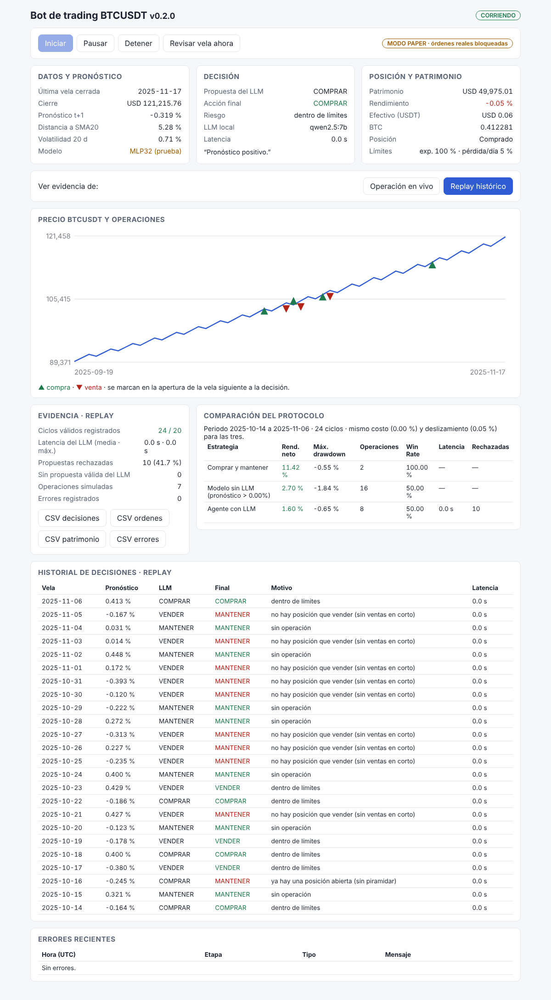
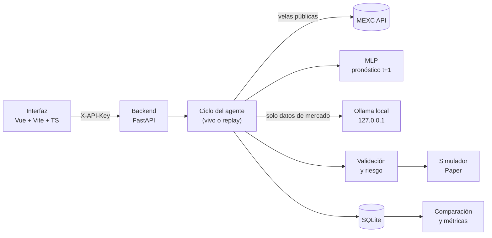

# Bot de trading BTC/USDT con LLM local

  
<!-- Cuando subas el repo, cambia TU_USUARIO/TU_REPO para ver el estado de las pruebas: -->
<!--  -->

Agente académico que cada día lee la vela cerrada de **BTC/USDT en MEXC**, calcula un pronóstico con una red neuronal (MLP) y le pide a un **LLM que corre en la propia computadora (Ollama)** una propuesta de compra, venta o mantener. La propuesta se valida, pasa por controles de riesgo fijos y se ejecuta en un **simulador Paper** (sin dinero real).

Proyecto final de la práctica de Deep Learning para Finanzas (Prof. Rubén Miguel Rodríguez Rangel), Ingeniería en Inteligencia Artificial, Universidad Iberoamericana León.

> **Aviso:** proyecto académico. No es asesoría financiera. Las órdenes reales están bloqueadas.



## Versión

**v0.2.0** (17 de noviembre de 2026). Ver [CHANGELOG.md](CHANGELOG.md).

## Tecnologías aplicadas

| Capa | Tecnología | Versión |
|---|---|---|
| Interfaz | Vue 3 + TypeScript | Vue 3.5, TypeScript 5.9 |
| Herramienta de compilación | Vite | 7.3 |
| Backend / API | Python + FastAPI + Uvicorn | Python 3.11+, FastAPI 0.115, Uvicorn 0.34 |
| Validación de datos | Pydantic | 2.11 |
| Cliente HTTP | HTTPX | 0.28 |
| LLM local | Ollama + Qwen2.5 7B (configurable) | Ollama 0.x |
| Modelo de pronóstico | MLP (PyTorch en Colab, inferencia con NumPy) | NumPy 1.26+ |
| Base de datos | SQLite | incluida en Python |
| Datos de mercado | API pública spot v3 de MEXC | — |
| Pruebas | pytest | 8.3 |
| Integración continua | GitHub Actions | — |

## Arquitectura



**Ciclo diario** (una sola decisión por vela):
1. Lee las velas diarias de MEXC y separa las cerradas de la vela en curso. Rechaza el dato si la última vela cerrada tiene más de `ANTIGUEDAD_MAX_H` horas.
2. Calcula los 20 rendimientos más recientes, la SMA de 20 días, la distancia a la SMA y la volatilidad de 20 días.
3. El MLP estima el rendimiento del día siguiente.
4. El LLM local responde en JSON: `accion` (COMPRAR, VENDER o MANTENER), `simbolo`, `fecha_vela` y `justificacion`.
5. Se valida la respuesta: JSON correcto, acción del catálogo, mismo símbolo y misma vela. Si falla, se mantiene sin operar.
6. Se aplican los controles de riesgo. El LLM no puede modificarlos.
7. Se ejecuta en Paper al precio de apertura de la vela siguiente, con deslizamiento.
8. Se guarda todo en SQLite con su origen (`vivo` o `replay`) y se muestra en la interfaz.

## Novedades de la v0.2

### Modo replay (evidencia de 20+ ciclos)

Recorre velas diarias históricas de MEXC con **exactamente el mismo ciclo**: el mismo MLP, el mismo LLM, el mismo riesgo y el mismo Paper.
- Cada ciclo corresponde a una vela diaria, así que la frecuencia de decisión no se acelera.
- Todo queda marcado como `replay` y no se mezcla con la operación en vivo.

```bash
cd backend
python -m app.replay --desde 2026-09-01 --ciclos 25     # requiere Ollama corriendo
```

Al terminar escribe `docs/comparacion_replay.md`. En el panel, el botón **Replay histórico** muestra esa evidencia.

### Comparación del protocolo

Compara en el mismo periodo, con el mismo costo, el mismo deslizamiento y el mismo precio de ejecución:
- **Comprar y mantener.**
- **Modelo sin LLM:** comprado si el pronóstico supera `UMBRAL_MODELO`.
- **Agente con LLM.**

Reporta rendimiento neto (con liquidación final), máximo drawdown, operaciones, Win Rate, latencia media del LLM y acciones rechazadas. Está disponible en el panel, en `GET /api/comparacion?origen=vivo|replay` y en el archivo generado por el replay.

### Panel con gráfica, métricas y exportación

- **Gráfica de precio:** muestra las compras (▲) y ventas (▼) en la vela en que se ejecutaron.
- **Evidencia:**
  - Ciclos válidos contra la meta de 20.
  - Latencia media y máxima del LLM.
  - Porcentaje de propuestas rechazadas.
  - Operaciones y errores.
- **Exportación:** botones para descargar en CSV las decisiones, órdenes, patrimonio y errores, como evidencia para el informe.

### Validación del modelo con datos de MEXC

El MLP se entrenó con BTC-USD de Yahoo Finance. Este comando mide su error con los precios reales de BTCUSDT en MEXC y lo compara con el pronóstico cero:

```bash
cd backend && python -m app.validar        # genera docs/validacion_mexc.md
```

### Integración continua

En cada `push`, GitHub Actions corre las pruebas del backend y compila la interfaz: [.github/workflows/ci.yml](.github/workflows/ci.yml).

## Seguridad

- **No se pasa ninguna API a la IA.** El prompt se arma solo con datos de mercado, el pronóstico y el estado de la cartera, a partir de una lista cerrada de campos. Claves, rutas y variables de entorno nunca llegan al LLM, y una prueba automática lo verifica.
- **Solo LLM local.** El backend no arranca si `OLLAMA_URL` no apunta a `localhost` o `127.0.0.1`.
- **Sin claves de MEXC.** Solo se usan endpoints públicos, y no existe código que firme peticiones ni envíe órdenes. `MODO` distinto de `PAPER` detiene el arranque.
- **Secretos fuera del repositorio.** `BOT_API_KEY` vive solo en `.env`, que está en `.gitignore`. La interfaz pide la clave al entrar y la guarda únicamente en la pestaña abierta.
- **API protegida.** Todas las rutas, salvo `/api/salud`, exigen el encabezado `X-API-Key`. El backend escucha solo en `127.0.0.1`.

## Controles de riesgo (en `.env`)

| Variable | Valor por defecto | Qué controla |
|---|---|---|
| `CAPITAL_INICIAL` | 50000 | USDT simulados al inicio |
| `EXPOSICION_MAX` | 1.0 | Fracción máxima del efectivo por compra (≤ 1: sin apalancamiento) |
| `PERDIDA_DIARIA_MAX` | 0.05 | Si el patrimonio cae 5 % en el día, se bloquean las compras |
| `ANTIGUEDAD_MAX_H` | 26 | Edad máxima de la última vela cerrada |
| `COSTO` | 0.0 | Comisión por operación |
| `DESLIZAMIENTO` | 0.0005 | Compra 0.05 % más cara y venta 0.05 % más barata |
| `UMBRAL_MODELO` | 0.0 | Umbral del "modelo sin LLM" en la comparación |

También se aplican siempre estas reglas:
- No hay ventas en corto.
- No se compra si ya hay una posición abierta.
- La cantidad se redondea hacia abajo a la precisión del par.
- Se respeta el monto mínimo de orden de MEXC.

## Requisitos

- Python 3.11 o superior
- Node.js 20 o superior
- [Ollama](https://ollama.com) instalado en la misma computadora

## Instalación y uso

```bash
# 1. LLM local
ollama pull qwen2.5:7b
ollama serve                     # escucha en 127.0.0.1:11434

# 2. Configuración
cp .env.example .env
python -c "import secrets; print(secrets.token_urlsafe(32))"   # pega el resultado en BOT_API_KEY

# 3. Backend
cd backend
python -m venv .venv
source .venv/bin/activate        # Windows: .venv\Scripts\activate
pip install -r requirements.txt
uvicorn app.main:create_app --factory --host 127.0.0.1 --port 8000

# 4. Interfaz (en otra terminal)
cd frontend
npm install
npm run dev                      # abre http://127.0.0.1:5173
```

En la interfaz, escribe tu `BOT_API_KEY` y presiona **Iniciar**. **Revisar vela ahora** fuerza la revisión de la última vela; si ya se procesó, no hace nada. **Pausar** deja de revisar y **Detener** termina el ciclo.

**Modelo:** coloca `models/modelo_mlp.json` exportado desde Colab (ver [models/README.md](models/README.md)). Sin ese archivo, el bot usa el pronóstico cero y lo indica en la interfaz.

## API

Documentación interactiva en `http://127.0.0.1:8000/docs`.

| Método | Ruta | Descripción |
|---|---|---|
| GET | `/api/salud` | Versión y modo (sin clave) |
| GET | `/api/estado` | Estado del bot, modelo, cartera, patrimonio, riesgo y último ciclo |
| POST | `/api/control/{iniciar\|pausar\|detener}` | Control del bot |
| POST | `/api/ciclo` | Revisa la vela ahora |
| GET | `/api/llm` | Versión de Ollama y disponibilidad del modelo |
| GET | `/api/metricas?origen=` | Ciclos, latencia, rechazos, operaciones y errores |
| GET | `/api/comparacion?origen=` | Comprar y mantener vs. modelo sin LLM vs. agente |
| GET | `/api/grafica?origen=` | Velas y órdenes para la gráfica |
| GET | `/api/exportar/{decisiones\|ordenes\|patrimonio\|errores}?origen=` | Descarga en CSV |
| GET | `/api/decisiones`, `/api/ordenes`, `/api/errores`, `/api/patrimonio` | Historial (`origen=vivo` o `replay`) |

## Pruebas

```bash
cd backend
python -m pytest -q
```

Son 32 pruebas. Entre ellas están los 9 errores provocados que pide el protocolo:
- API de MEXC sin respuesta o con límite de solicitudes
- Dato atrasado
- Ollama detenido
- JSON inválido del LLM
- Clave incorrecta
- Saldo insuficiente
- Evento duplicado
- Reinicio del backend sin duplicar operaciones
- Botón de detener

También cubren la comparación calculada a mano, la separación entre replay y vivo, las métricas, la exportación y la validación.

## Estructura

```
├── .github/workflows/ci.yml   # pruebas y build en cada push
├── backend/
│   ├── app/
│   │   ├── main.py         # API FastAPI
│   │   ├── agente.py       # ciclo del agente y control (iniciar/pausar/detener)
│   │   ├── replay.py       # modo replay sobre velas históricas
│   │   ├── comparacion.py  # comparación del protocolo
│   │   ├── validar.py      # validación del MLP con datos de MEXC
│   │   ├── mexc.py         # datos públicos de MEXC
│   │   ├── modelo.py       # variables y MLP (NumPy)
│   │   ├── llm.py          # Ollama local + validación de la propuesta
│   │   ├── paper.py        # simulador Paper y riesgo
│   │   ├── db.py           # SQLite (con origen vivo/replay) y exportación CSV
│   │   └── config.py       # configuración desde .env
│   ├── tests/
│   └── requirements.txt
├── frontend/               # Vue 3 + Vite + TypeScript
├── models/                 # modelo_mlp.json versionado
├── scripts/                # exportación del modelo desde Colab
├── docs/                   # capturas, comparación y validación generadas
├── .env.example
├── CHANGELOG.md
└── LICENSE
```

## Decisiones de diseño

- **Mercado:** MEXC spot BTC/USDT, porque el modelo de la práctica pronostica rendimientos diarios de BTC. Polymarket se consideró como alternativa, pero opera mercados de predicción sobre eventos, no el precio de un activo como el que pronostica el MLP.
- **Interfaz:** Vue + Vite + TypeScript, según la recomendación del profesor.
- **Replay:** se guarda en la misma base de datos, separado por la columna `origen`, para comparar ambos con las mismas consultas.
- **Base de datos nueva en v0.2** (`data/bot_v2.sqlite`), porque cambió el esquema (columna `origen`).

## Próximos pasos

- [ ] Exportar el MLP del avance 2 desde Colab y versionar `models/modelo_mlp.json`.
- [ ] Correr el replay y la validación con datos reales de MEXC y subir los `.md` generados en `docs/`.
- [ ] Documentar los 9 errores provocados con capturas del panel.
- [ ] Agregar un proxy con autenticación delante de Ollama.

## Autora

Lyzzet Valenzuela Cabello. Ingeniería en Inteligencia Artificial, Universidad Iberoamericana León.

## Licencia

[MIT](LICENSE)
